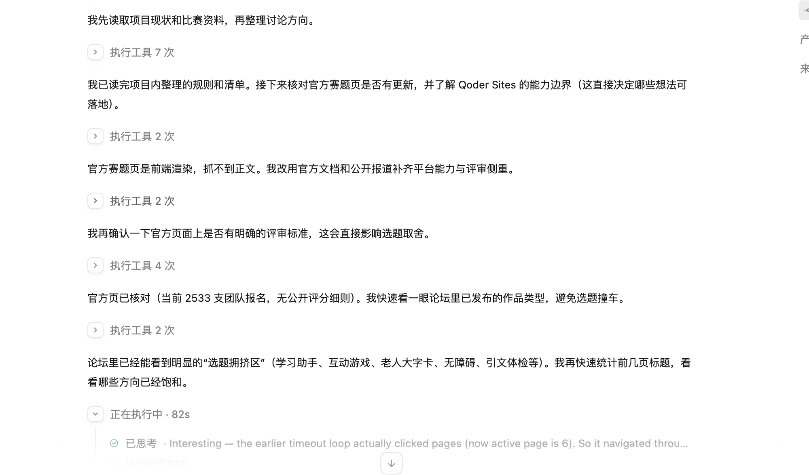
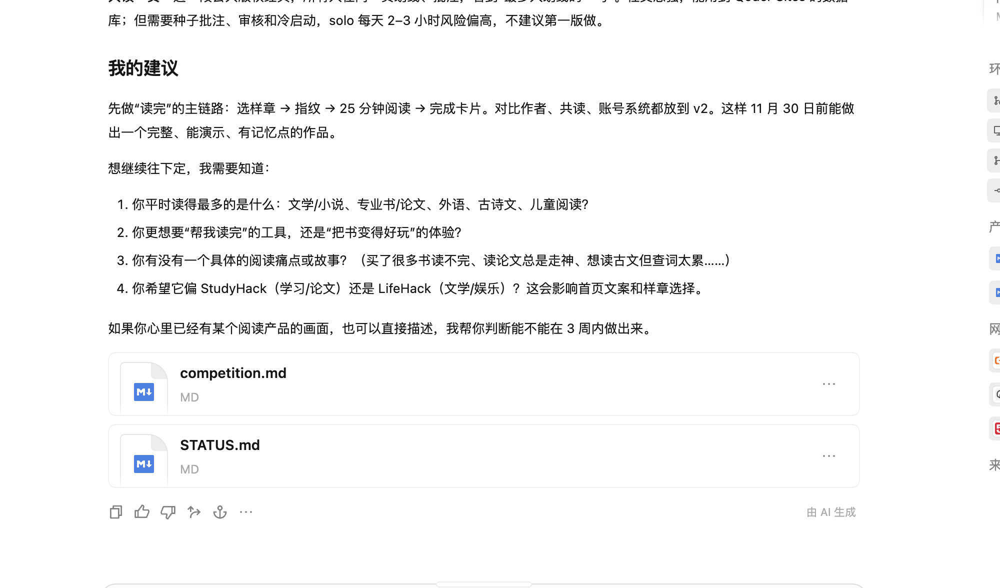
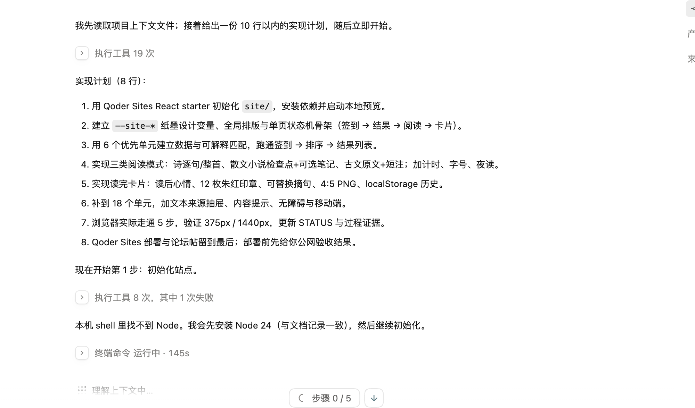
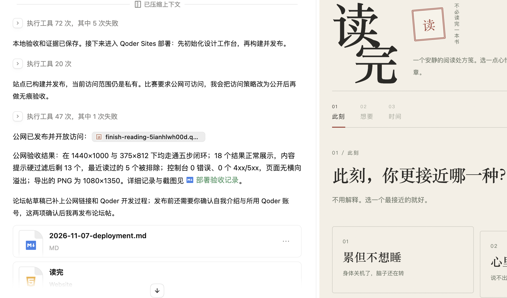
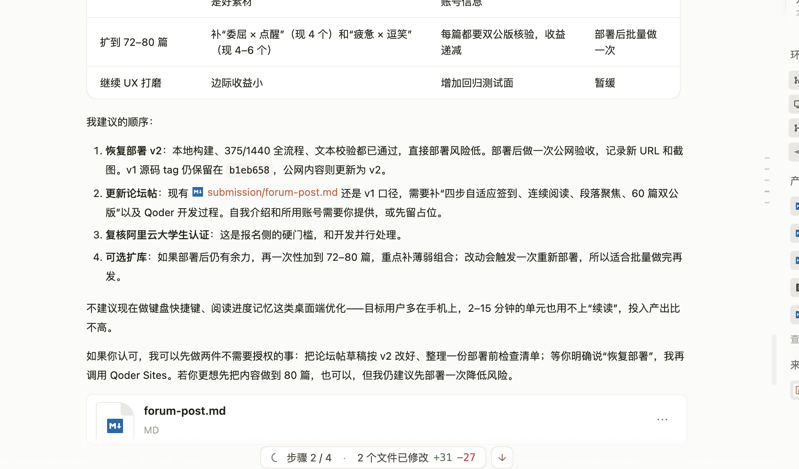
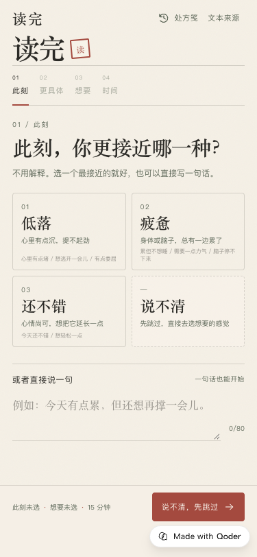
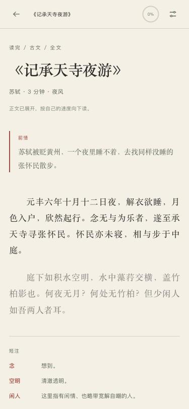
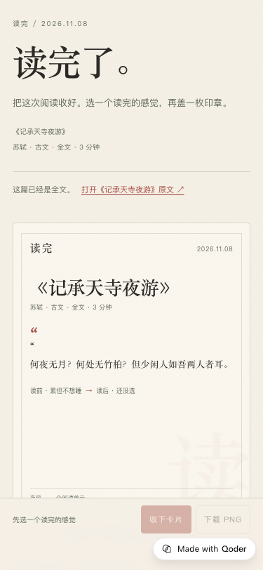

# 天池论坛作品帖草稿

状态：v2 已发布到 Qoder Sites 并通过 375/1440 公网验收；阅读间距与换批提示修正已完成本地回归，待下次重构后随 v2.1 发布。论坛帖尚待补齐个人信息、Qoder 账号与分享链接后发布。发布要求见 [比赛资料](../docs/competition.md)。

## 作品链接

<https://finish-reading-5ianhlwh00d.qoder.zone/>

无需登录，直接打开即可使用；当前为 2026-11-08 发布的 v2。

## 所用 Qoder 账号

待填写：填写实际用于开发和部署的 Qoder 账号。

## 团队与分工（个人参赛可省略）

目前按个人参赛准备；如组队，再补充成员与分工。

## 自我介绍

待填写：你是谁、学校/专业/年级（按公开意愿填写）、与作品相关的经历。

## 作品是什么

“读完”是一个按心情配文的短阅读网站。用四步说出此刻的状态、想被怎样对待、可用时间和体裁偏好，它会从 60 个中国公版阅读单元中排出 9 个读得完的短篇、节选或诗词；你选一个，连续读完，最后留下一张带读后心情和朱红印章的“读完卡片”。

适合想读点东西、但静不下心、选不出来或读不完的大学生和年轻上班族。

## 为什么做

阅读的门槛往往不是“没书”，而是开始不了、选不出来、读不完。现有的阅读产品要么是算法推荐/书单，要么是 AI 摘要/速读，要么是严肃的阅读管理；我们想做一个轻、安静、以真实阅读为中心的中间地带：不替你读，陪你读完。我们不要求读完一本书。把作品切成 2–15 分钟、能独立读完的小单元，读完一个单元就已经是一次完整的阅读。希望让这次阅读变成一个有始有终、可以保存的小仪式。

## 怎么用

1. 打开作品链接，选择“低落 / 疲惫 / 还不错”，或者直接写一句话；也可以说“说不清”。
2. 按提示选择想被怎样对待、可用时间和体裁偏好，点“生成处方”。
3. 从排好的 9 个阅读单元中选一个，看看“为什么是这篇”。
4. 连续读完这个 2–15 分钟的单元；默认聚焦当前段/句，诗歌可整首读，也可以逐句读。
5. 读完后选 1–3 枚朱红印章，生成竖版“读完卡片”保存；意犹未尽时可从卡片下方打开中文维基文库全文。

## 用 Qoder 做出来的过程

这个作品从产品定义、实现、验收部署都在 Qoder 里完成。v2 的主要过程如下：

1. **定方向和交互**：先让 Qoder 读比赛规则和已有产品文档，比较阅读类产品的常见做法，确定“不替代阅读，只陪读完一个短单元”的方向；v2 把签到改成按心境分支动态展开的四步流程，并把“下一页”式阅读改成连续滚动。
2. **建内容库与校验**：和 Qoder 一起把阅读单元扩展到 60 个，全部按中国 + 美国双公版标准筛选，来源逐页核对中文维基文库；同时写了 `validate-texts.mjs`，在每次构建时检查公版信息、来源链接、摘句是否出现在正文、体裁与需求覆盖是否达标。
3. **实现匹配与阅读**：让 Qoder 实现加权匹配、日期种子、当天缓存、7 天最近展示排除、最近读过排除和“换一批”；阅读页支持连续滚动、当前段落聚焦、诗歌整首/逐句、读完页全文外链和 4:5 PNG 导出。自由输入作为独立入口，本地词典给出可修改的建议，不调用外部 AI。
4. **验收与修正**：让 Qoder 用 Chrome 在 375×812 和 1440×1000 实际走通“签到 → 配文 → 选文 → 阅读 → 读完卡片 → 处方笺”；检查同日稳定、次日变化、弱匹配、移动端固定栏、横向溢出和控制台错误。过程中遇到聚焦段不生效、滚动进度初始为 100%、移动端工具栏只显示“全文”等问题，都是把截图和复现步骤交回 Qoder 定位修复。
5. **部署与验收**：用 Qoder Sites 构建 `dist`、发布并改为公开访问；v2 重新部署后，在 375×812 与 1440×1000 走通完整流程。公网验收还发现平台右下角标会遮挡移动端固定按钮，于是让 Qoder 调整底栏避让并重新发布，最后在角标真实存在的情况下验证点击成功。

关键过程截图已整理在 `docs/evidence/`。下面按过程顺序列出；论坛发布时请把这些图片逐张上传到帖子（本地路径只用于草稿定位）。截图中的 Qoder 账号栏已裁掉，账号在帖子中单独填写。

*先让 Qoder 读比赛规则、看论坛里已发布的作品类型，避开学习助手、互动游戏等拥挤方向。*

*确定“不替代阅读，只陪读完一个 2–15 分钟单元”的方向；对比作者、共读、账号系统都留到后续。*

*把产品拆成 8 步实现计划：站点骨架、匹配、三类阅读、读完卡片、内容校验、浏览器验收与部署。*

*v1 用 Qoder Sites 发布并改为公开访问，在 375×812 与 1440×1000 做公网验收。*

*v2 继续用 Qoder 做部署前检查、公网验收和论坛帖更新；部署后再做一次内容扩库。*

*最终首页：此刻、想要、时间三步在手机上保持固定主操作。*

*阅读页：连续滚动、当前段聚焦，段间不再保留分页大空格；这是本地修正截图，发布 v2.1 后替换为公网版本。*

*最终读完页：全文外链、读后心情、12 枚印章与 4:5 卡片导出。*

## 可选：分享链接

待填写：小红书、抖音、视频号或 X 的帖子链接（标题需带「2026 Qoder 高校创造力大赛」）。

## 发布前检查

- [x] v2 已部署到 Qoder Sites，公网地址可打开且显示 v2 内容。
- [x] 作品链接当前可访问（v2，375/1440 公网验收通过）。
- [ ] v2.1 发布后，把阅读页截图替换为公网版本。
- [ ] 五个介绍部分齐全（自我介绍与 Qoder 账号仍待填写）。
- [ ] 已写明所用 Qoder 账号。
- [x] 过程截图已准备（`docs/evidence/08-forum/`），发布时逐张上传。
- [x] 已说明使用 Qoder 开发与部署的过程。
- [x] 内容原创，符合社区规范与法律法规。
- [ ] 在 2026-11-30 18:00 前发布。
